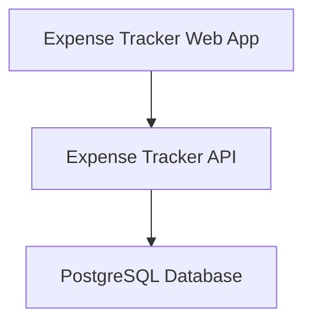
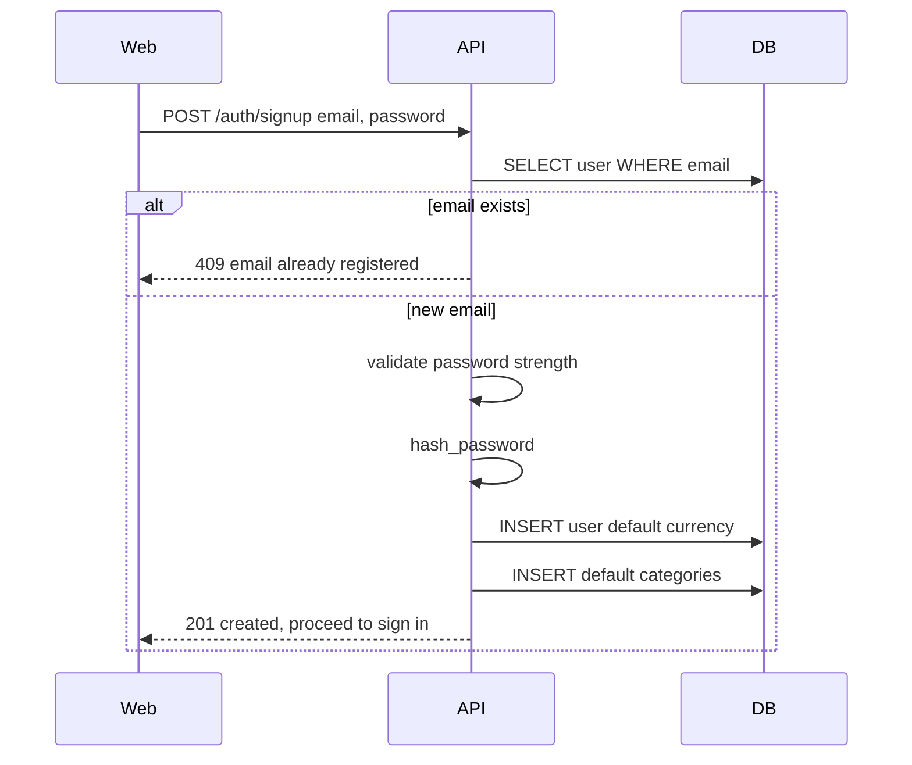
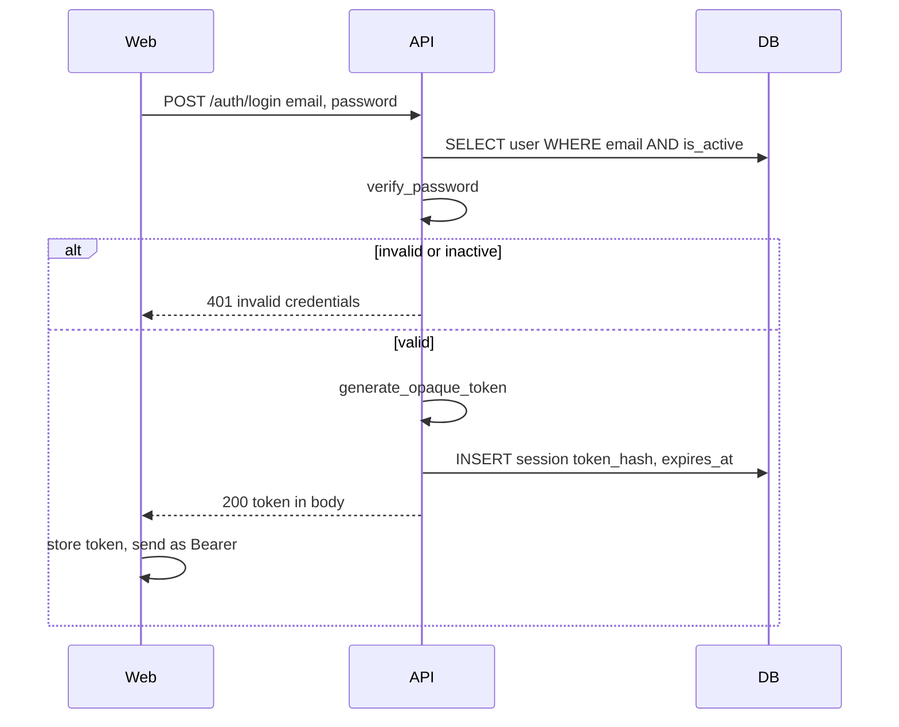
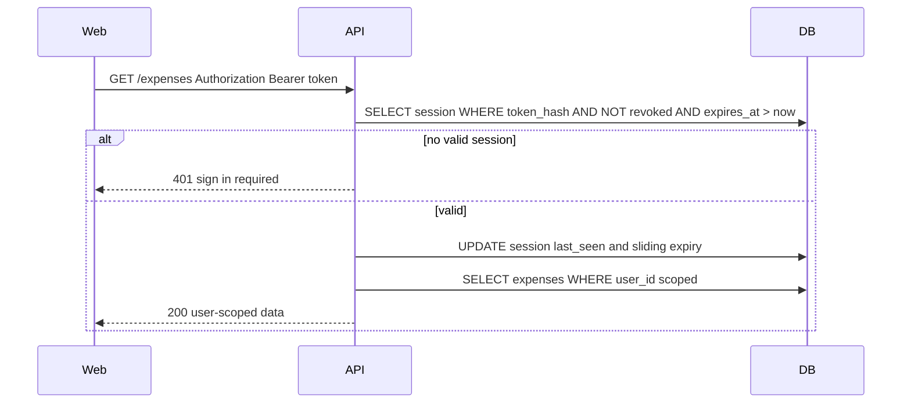
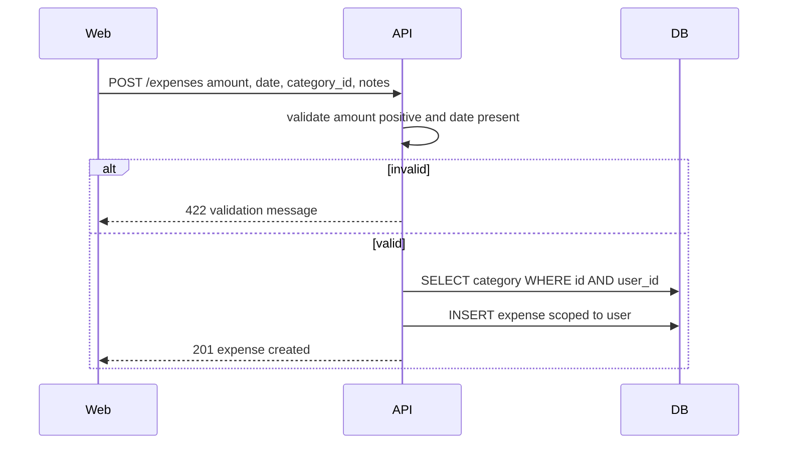
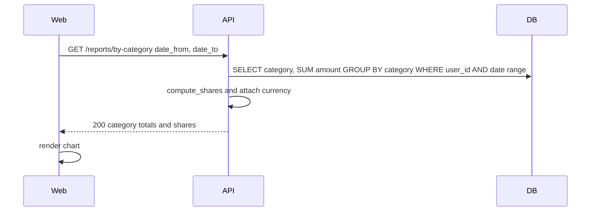
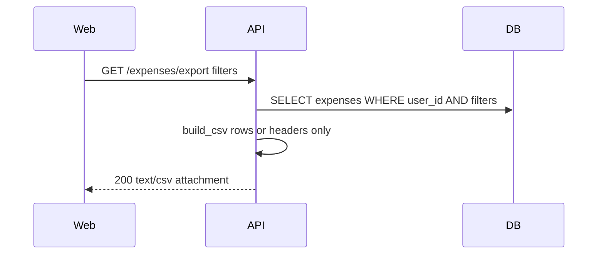
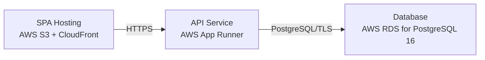

# Architecture

> Maintained by QuorQ AI SDLC. Text between `sdlc:auto` markers is regenerated; anything outside them is yours and is kept.

<!-- sdlc:auto:start narrative -->
## Overview

### COMP-WEB · approved · source: architecture:components

React 19 responsive SPA that provides sign-in, expense entry, filterable history, category management, settings, dashboard/charts, and CSV export triggering.

Component: Expense Tracker Web App (React 19). Responsibilities: sign-in UI, expense entry and filterable history, category management, settings, dashboard and charts, triggering CSV export. Stores the opaque session token client-side and sends it as Authorization: Bearer on every API call. Reads the API base URL from the VITE_API_BASE_URL environment variable. Communicates with the api component from a separate origin.

**Related:** TECH-FRONTEND, DEPLOY-SPA, EP-AUTH, EP-EXPENSES, EP-REPORTS

### COMP-API · approved · source: architecture:components

FastAPI 0.115 backend exposing authentication, expense/category CRUD, settings, report aggregation and CSV export.

Component: Expense Tracker API (FastAPI 0.115). Responsibilities: authentication, expense CRUD, category management, settings, report aggregation, CSV export. Validates amount/date/category input, enforces per-user data isolation, hashes passwords (bcrypt), and manages server-side opaque sessions (create, validate, expire, revoke). Sits between the web SPA and the db component.

**Related:** TECH-BACKEND, DEPLOY-API, EP-AUTH, EP-SETTINGS, EP-CATEGORIES, EP-EXPENSES, EP-REPORTS, COMP-DB

### COMP-DB · approved · source: architecture:components

Managed PostgreSQL 16 relational store for users, sessions, categories and expenses, providing exact numeric money storage and SQL aggregation.

Component: PostgreSQL Database (PostgreSQL 16). Responsibilities: durable storage for users, sessions, categories, expenses. Provides exact numeric money storage and SQL aggregation for reports (SUM/GROUP BY category and time period). Durability backed by the managed AWS RDS service's automated backups.

**Related:** TECH-DATABASE, DEPLOY-DB, DATA-MODEL, COMP-API

### CP-SIGNUP · approved · source: architecture:critical-path:signup

New-user registration flow that validates credentials and provisions default data for the account.

Critical path: Sign up and provision defaults. A new user registers; email uniqueness and password strength are validated, the password is bcrypt-hashed, a default currency is set, and a default category set (food, transport, housing, plus an uncategorised fallback) is created for the account.

**Related:** COMP-API, COMP-DB, EP-AUTH, DATA-MODEL

### CP-SIGNIN · approved · source: architecture:critical-path:signin

Sign-in flow that authenticates credentials and creates a server-side opaque session.

Critical path: Sign in and session creation. User submits credentials. On success an opaque token is generated, its hash stored in the sessions table with an expiry, and the raw token returned in the response body for the SPA to store.

**Related:** COMP-API, COMP-DB, EP-AUTH, DATA-MODEL

### CP-AUTHREQ · approved · source: architecture:critical-path:authenticated-request

Per-request session validation and user-scoping enforced on every protected endpoint.

Critical path: Authenticated request with session validation. Every protected endpoint resolves the Bearer token to a live, non-expired, non-revoked session and scopes all queries to that user_id, enforcing privacy and session expiry.

**Related:** COMP-API, COMP-DB, DATA-MODEL

### CP-RECORDEXPENSE · approved · source: architecture:critical-path:record-expense

Expense creation flow with validation and category/fallback handling.

Critical path: Record an expense. User submits an expense. Amount must be positive numeric, date required, category must belong to the user (or the fallback category is applied). The row is written scoped to the user and appears in history and reports.

**Related:** COMP-API, COMP-DB, EP-EXPENSES, DATA-MODEL

### CP-CATEGORYREPORT · approved · source: architecture:critical-path:category-report

Category-totals report flow using SQL aggregation over a date range.

Critical path: Spending-by-category report. User requests category totals for a period. The API aggregates the user's expenses with SQL SUM and GROUP BY category over the date range and returns totals and shares formatted in the user's currency.

**Related:** COMP-API, COMP-DB, EP-REPORTS, DATA-MODEL

### CP-EXPORTCSV · approved · source: architecture:critical-path:export-csv

CSV export flow honoring filters, scoped strictly to the requesting user's own data.

Critical path: Export filtered history as CSV. User requests CSV export honouring any category/date filters. The API streams a CSV with amount, date, category and notes columns for the user's own rows only, returning headers only when nothing matches.

**Related:** COMP-API, EP-EXPENSES, DATA-MODEL

### DATA-MODEL · approved · source: architecture:entities

Four core relational entities: users, sessions, categories, expenses, all scoped by user_id for per-user isolation.

Entities:
- users: id, email, password_hash, currency, is_active, created_at.
- sessions: id, user_id, token_hash, created_at, last_seen_at, expires_at, revoked.
- categories: id, user_id, name, is_default, is_fallback, created_at.
- expenses: id, user_id, category_id, amount, expense_date, notes, created_at, updated_at.
All tables other than users carry user_id (directly or via category_id) to support per-user data isolation.

**Related:** COMP-DB, COMP-API

### EP-AUTH · approved · source: architecture:endpoints:auth

Authentication and account-lifecycle endpoints: signup, login, logout, change-password, deactivate.

Endpoints:
- POST /auth/signup - register a new account with email and password; validates uniqueness and password strength, hashes the password, seeds default categories.
- POST /auth/login - authenticate credentials and create a server-side session; returns the opaque token in the body.
- POST /auth/logout - revoke the current session server-side.
- POST /auth/change-password - change password after verifying current password; stores new password as a hash.
- POST /auth/deactivate - deactivate the account and revoke all its active sessions.

**Related:** COMP-API, CP-SIGNUP, CP-SIGNIN, CP-AUTHREQ, DATA-MODEL

### EP-SETTINGS · approved · source: architecture:endpoints:settings

Endpoints to read and update the user's single display currency.

Endpoints:
- GET /settings - return the current user's settings including configured currency.
- PUT /settings - update the single display currency from the supported list; no numeric conversion applied.

**Related:** COMP-API, DATA-MODEL

### EP-CATEGORIES · approved · source: architecture:endpoints:categories

CRUD endpoints for custom categories, including fallback reassignment on deletion.

Endpoints:
- GET /categories - list the current user's categories (default and custom).
- POST /categories - create a custom category with a non-empty, non-duplicate name.
- PUT /categories/{id} - rename a custom category to a valid, non-duplicate name; applies everywhere it appears.
- DELETE /categories/{id} - delete a custom category; reassigns affected expenses to the fallback category on confirmation.

**Related:** COMP-API, DATA-MODEL, CP-RECORDEXPENSE

### EP-EXPENSES · approved · source: architecture:endpoints:expenses

CRUD and export endpoints for a user's expense records, with filtering by category and date range.

Endpoints:
- GET /expenses - list the user's expenses, most recent first, with optional category and date-range filters.
- POST /expenses - create an expense with positive amount, date, category and optional notes.
- GET /expenses/{id} - fetch a single expense owned by the user.
- PUT /expenses/{id} - update an expense's amount, date, category or notes; invalid values rejected, originals preserved.
- DELETE /expenses/{id} - delete an expense so it no longer counts in reports or exports.
- GET /expenses/export - export the user's expenses as CSV honouring category/date filters; headers only when nothing matches.

**Related:** COMP-API, DATA-MODEL, CP-RECORDEXPENSE, CP-EXPORTCSV

### EP-REPORTS · approved · source: architecture:endpoints:reports

Reporting endpoints for the dashboard, category breakdown and spending-over-time aggregation.

Endpoints:
- GET /reports/dashboard - return summary figures (recent-period total) and a spending breakdown for the dashboard, with empty-state support.
- GET /reports/by-category - aggregate spending grouped by category for a date range, with totals and shares in the user's currency.
- GET /reports/over-time - aggregate total spending over time by day/week/month for a date range, in the user's currency.

**Related:** COMP-API, DATA-MODEL, CP-CATEGORYREPORT

### DEPLOY-SPA · approved · source: architecture:deployment-nodes

Static hosting node for the React SPA build.

Deployment node: SPA Hosting on AWS S3 + CloudFront, serving the static React 19 build.

**Related:** COMP-WEB, TECH-CLOUD

### DEPLOY-API · approved · source: architecture:deployment-nodes

Managed compute node running the FastAPI service.

Deployment node: API Service on AWS App Runner, running FastAPI 0.115 on Python 3.12 via Uvicorn.

**Related:** COMP-API, TECH-CLOUD

### DEPLOY-DB · approved · source: architecture:deployment-nodes

Managed database node hosting PostgreSQL 16.

Deployment node: Database on AWS RDS for PostgreSQL, running managed PostgreSQL 16.

**Related:** COMP-DB, TECH-CLOUD

### TECH-FRONTEND · approved · source: architecture:technology-decisions:frontend

React 19 chosen as the approved frontend stack over Vue and Svelte.

Decision: Frontend = React 19 (alternatives considered: Vue, Svelte). Approved stack. Built as a Vite SPA serving the expense form, filterable history, settings and chart-driven dashboard/reports; holds the opaque session token and sends it as Authorization: Bearer, reading the API base URL from VITE_API_BASE_URL.

**Related:** COMP-WEB

### TECH-BACKEND · approved · source: architecture:technology-decisions:backend

FastAPI 0.115 chosen as the approved backend stack over Flask and Django REST Framework.

Decision: Backend = FastAPI 0.115 (alternatives considered: Flask, Django REST Framework). Approved stack. Handles sign-in, expense/category CRUD, settings, SQL-backed report aggregation and in-process CSV generation; Pydantic validation keeps amount/date/category input clean on entry.

**Related:** COMP-API

### TECH-DATABASE · approved · source: architecture:technology-decisions:database

PostgreSQL 16 chosen as the approved database over MySQL and SQLite.

Decision: Database = PostgreSQL 16 (alternatives considered: MySQL, SQLite). Approved stack. Stores users, sessions, categories and expenses as related records with exact numeric money values, and powers category/time aggregation via SUM and GROUP BY; per-user scoping isolates each account's data.

**Related:** COMP-DB, DATA-MODEL

### TECH-CLOUD · approved · source: architecture:technology-decisions:cloud

AWS chosen as the approved cloud provider over Google Cloud and Azure.

Decision: Cloud = AWS (alternatives considered: Google Cloud, Azure). Approved stack. Hosts the static SPA (S3/CloudFront), the FastAPI service (App Runner) and managed PostgreSQL (RDS) in one place, with RDS automated backups protecting expense history and auto-scaling for growth.

**Related:** DEPLOY-SPA, DEPLOY-API, DEPLOY-DB
<!-- sdlc:auto:end narrative -->

<!-- sdlc:auto:start building-blocks -->
## Building Block View

| ID | Name | Technology | Responsibility | Depends on |
|---|---|---|---|---|
| web | Expense Tracker Web App | React 19 | Responsive SPA for sign-in, expense entry, filterable history, category management, settings, dashboard and charts, and triggering CSV export. Stores the opaque session token and sends it as Authorization: Bearer on every API call. Reads the API base URL from VITE_API_BASE_URL. | api |
| api | Expense Tracker API | FastAPI 0.115 | FastAPI backend exposing authentication, expense CRUD, category management, settings, report aggregation and CSV export. Validates amount/date/category input, enforces per-user data isolation, hashes passwords, and manages server-side opaque sessions (create, validate, expire, revoke). | db |
| db | PostgreSQL Database | PostgreSQL 16 | Managed relational store for users, sessions, categories and expenses. Provides exact numeric money storage and SQL aggregation for reports (sum/group by category and by time period). Backed up by the managed service for durability. | — |

<!-- sdlc:auto:end building-blocks -->

<!-- sdlc:auto:start runtime -->
## Runtime View

### Sign up and provision defaults

New user registers. Email uniqueness and password strength are validated, the password is bcrypt-hashed, a default currency is set, and the default category set (food, transport, housing, plus an uncategorised fallback) is created for the account.

- **Components:** web, api, db
- **Modules:** auth_router, auth_service, password_hasher, category_service, user_repository
- **Key functions:** signup(email, password), hash_password(password), seed_default_categories(user_id), create_user(email, password_hash, currency)

### Sign in and session creation

User submits credentials. On success an opaque token is generated, its hash stored in the sessions table with an expiry, and the raw token returned in the response body for the SPA to store.

- **Components:** web, api, db
- **Modules:** auth_router, auth_service, session_service, password_hasher
- **Key functions:** login(email, password), verify_password(password, hash), create_session(user_id), generate_opaque_token()

### Authenticated request with session validation

Every protected endpoint resolves the Bearer token to a live, non-expired, non-revoked session and scopes all queries to that user_id, enforcing privacy and session expiry.

- **Components:** web, api, db
- **Modules:** auth_dependency, session_service
- **Key functions:** get_current_user(authorization), validate_session(token), touch_session(session_id)

### Record an expense

User submits an expense. Amount must be positive numeric, date required, category must belong to the user (or fallback applied). The row is written scoped to the user and appears in history and reports.

- **Components:** web, api, db
- **Modules:** expense_router, expense_service, expense_schema, category_repository
- **Key functions:** create_expense(user_id, amount, date, category_id, notes), validate_expense(payload), resolve_category(user_id, category_id)

### Spending-by-category report

User requests category totals for a period. The API aggregates the user's expenses with SQL SUM and GROUP BY category over the date range and returns totals and shares formatted in the user's currency.

- **Components:** web, api, db
- **Modules:** reports_router, reports_service, expense_repository
- **Key functions:** category_breakdown(user_id, date_from, date_to), compute_shares(totals)

### Export filtered history as CSV

User requests CSV export honouring any category/date filters. The API streams a CSV with amount, date, category and notes columns for the user's own rows only, returning headers only when nothing matches.

- **Components:** web, api, db
- **Modules:** export_router, export_service, expense_repository
- **Key functions:** export_csv(user_id, filters), build_csv(rows)

<!-- sdlc:auto:end runtime -->

<!-- sdlc:auto:start deployment-view -->
## Deployment View

| Name | Service | Runtime | Scaling | Environment |
|---|---|---|---|---|
| SPA Hosting | AWS S3 + CloudFront | Static React 19 build | CDN edge caching, effectively elastic | dev |
| API Service | AWS App Runner | FastAPI 0.115 on Python 3.12 (Uvicorn) | Auto-scaling on request concurrency | dev |
| Database | AWS RDS for PostgreSQL 16 | PostgreSQL 16 managed | Vertical resize plus automated backups | dev |

| Source | Target | Protocol |
|---|---|---|
| SPA Hosting | API Service | HTTPS |
| API Service | Database | PostgreSQL/TLS |

<!-- sdlc:auto:end deployment-view -->

<!-- sdlc:auto:start decisions -->
## Architecture Decisions

| Layer | Choice | ADR |
|---|---|---|
| Frontend | React 19 | [ADR-0001](adr/frontend.md) |
| Backend | FastAPI 0.115 | [ADR-0002](adr/backend.md) |
| Database | PostgreSQL 16 | [ADR-0003](adr/database.md) |
| Cloud | AWS | [ADR-0004](adr/cloud.md) |
<!-- sdlc:auto:end decisions -->

<!-- sdlc:auto:start links -->
## Related Documents

- [Data Model](data-model.md)
- [API Specification](api/openapi.yaml)
- [Architecture Decision Records](adr/README.md)
<!-- sdlc:auto:end links -->
