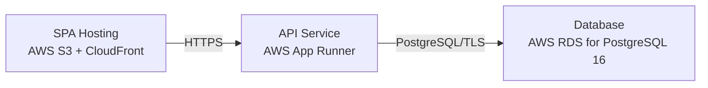

# Deployment Guide

> Maintained by QuorQ AI SDLC. Text between `sdlc:auto` markers is regenerated; anything outside them is yours and is kept.

<!-- sdlc:auto:start how-it-deploys -->
Pushes to `main` run `.github/workflows/deploy.yml`, which builds the API image (if there is a backend) and deploys the SPA to AWS Amplify. Commits touching only `docs/sdlc/**` don't deploy. Deployments can also be started from the platform's Deployment tab.
<!-- sdlc:auto:end how-it-deploys -->

<!-- sdlc:auto:start environments -->
| Name | Service | Runtime | Scaling | Environment |
|---|---|---|---|---|
| SPA Hosting | AWS S3 + CloudFront | Static React 19 build | CDN edge caching, effectively elastic | dev |
| API Service | AWS App Runner | FastAPI 0.115 on Python 3.12 (Uvicorn) | Auto-scaling on request concurrency | dev |
| Database | AWS RDS for PostgreSQL 16 | PostgreSQL 16 managed | Vertical resize plus automated backups | dev |
<!-- sdlc:auto:end environments -->

<!-- sdlc:auto:start live -->
**Frontend URL:** https://p05ccd2b740e7.dshared.amplifyapp.local

**Backend URL:** https://05ccd2b740e7.local.awsapprunner.local

**Database:** PostgreSQL · aisdlc_05ccd2b740e7

**Version:** bff834ee5861

**Commit:** `bff834e`

**Finished:** 2026-11-19
<!-- sdlc:auto:end live -->

<!-- sdlc:auto:start topology -->

<!-- sdlc:auto:end topology -->
